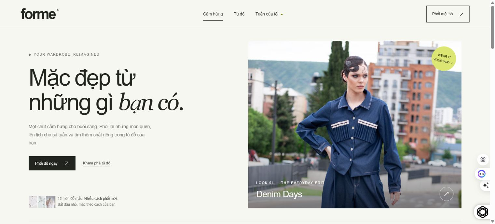

# FORME

**Mặc đẹp từ những gì bạn có.** A photo-led wardrobe and weekly outfit planner inspired by Runway.

[**Open Live Demo ↗**](https://nguyenhonggiang2407.github.io/FORME/) · [Source](https://github.com/nguyenhonggiang2407/FORME) · [Verification](docs/VALIDATION.md)

The public demo runs on GitHub Pages with no paid server or database. The deployed HTTPS application and all 26 resources were verified against the tested source, and its core interactions were tried in Chrome.



FORME turns fashion inspiration into a small daily routine: choose available pieces, save a combination, plan when to wear it, and pack only what the plan needs. It is an independent portfolio project, with original application code and licensed stock photography.

## What works

- Six editorial looks, with clearly labelled representative pieces to reinterpret them.
- Twelve wardrobe pieces, searchable by name and filtered by category, color and availability.
- A deterministic outfit builder using real catalogue items, occasion and manually chosen temperature. Cool-weather combinations require a layer. There are no AI or live-weather claims.
- Saved favorites and custom outfits, with local Monday-based calendar weeks.
- A date-range packing checklist that deduplicates repeated items and counts how many planned outfits use each piece.
- JSON backup/restore, with confirmation and an option to download the current backup before replacing it. Clipboard export and print-friendly packing lists are also available.

All personal state stays in this browser's `localStorage`. There are no accounts, cloud synchronization, payment services or databases. A visible notice appears if browser storage is unavailable. This release uses a fixed demonstration wardrobe; it does not upload your personal clothing photos.

## Run locally

Requires Node.js 20 or newer. There are no package dependencies or build steps.

```sh
npm run dev
```

Open the local address printed in the terminal. Any static host can serve `dist/`, including a project subpath. Routes use URL hashes, and assets use relative paths.

```sh
npm run check
npm test
```

The check verifies all photo hashes and attribution records, catalogue references, curated outfit tags and all 12 occasion/temperature combinations. The 11 domain tests cover persistence normalization, invalid data, calendar boundaries, outfit constraints, availability, packing and search.

To compare a deployed static copy against the local application:

```sh
node tools/verify-live.mjs https://nguyenhonggiang2407.github.io/FORME/
```

## Structure

| Path | Purpose |
| --- | --- |
| `dist/app.js` | Accessible browser UI and local persistence |
| `dist/domain.js` | Pure calendar, validation, outfit and packing logic |
| `dist/data.json` | Demonstration wardrobe and editorial inspiration |
| `dist/assets/` | 18 self-hosted stock photos, 1.58 MB total |
| `dist/credits.html` | Visitor-facing photo credits |
| `tests/` | Node built-in test runner; no external test dependencies |
| `.github/workflows/pages.yml` | Verification before publishing to GitHub Pages |

The photo files are covered by the Pexels License, separately from the application code. Editorial images do not depict the exact representative catalogue pieces; people and brands shown do not endorse FORME. See [full photo provenance](docs/ATTRIBUTION.md) and the [asset manifest](docs/media-manifest.json).

## Design relationship to Runway

Runway provides the starting idea of discovering outfits through strong fashion imagery. FORME develops a different workflow around rewearing, personal planning and packing. It reuses no Runway source code, photographs, database or secrets.
